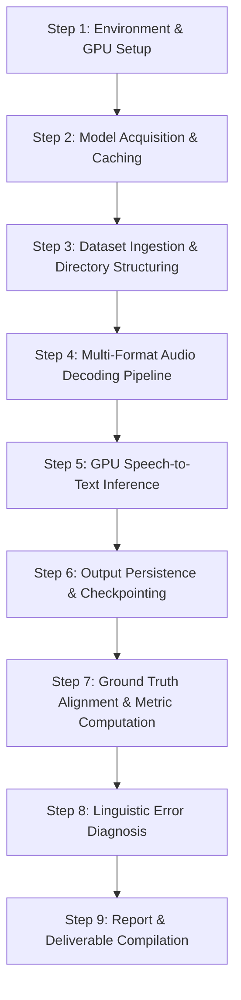

# End-to-End Methodology & Experiment Execution Report
**Meta SeamlessM4T v2 Speech-to-Text Benchmarking on Telugu Dialects (UROP)**

---

## 1. Executive Summary

This report documents the end-to-end methodology and sequential execution steps carried out for the Undergraduate Research Opportunities Program (**UROP**) project. The objective was to evaluate Meta AI's state-of-the-art **SeamlessM4T v2 Large** (`facebook/seamless-m4t-v2-large`) foundation speech model on a multi-dialect, multi-domain Telugu speech dataset comprising **900 natural audio recordings**.

The workflow spanned environment configuration, model acquisition, custom multi-codec audio decoding, GPU inference, transcript generation, ground truth alignment, automated quantitative metric computation (WER, CER, SacreBLEU), linguistic error analysis, and documentation.

---

## 2. Chronological Pipeline & Workflow Overview



---

## 3. Detailed Step-by-Step Execution

### Step 1: Environment & GPU Hardware Setup
* **Compute Platform**: Local workstation with an **NVIDIA GeForce RTX 3060 (12 GB GDDR6 VRAM)**.
* **Framework**: PyTorch (`2.11.0+cu128`) configured with CUDA acceleration.
* **Precision**: Half-precision floating point (`torch.float16`) to optimize memory footprint and maximize inference throughput on the 12 GB GPU.
* **Windows Console Encoding**: Windows command terminals default to legacy codepages (cp1252), causing `UnicodeEncodeError` when printing Telugu Unicode characters (`\u0c00`–`\u0c7f`). The environment was explicitly forced to UTF-8:
  ```python
  if sys.stdout.encoding != 'utf-8':
      sys.stdout.reconfigure(encoding='utf-8')
  if sys.stderr.encoding != 'utf-8':
      sys.stderr.reconfigure(encoding='utf-8')
  ```

### Step 2: Model Acquisition & Cache Isolation
* **Model Selected**: Meta's **SeamlessM4T v2 Large** (`facebook/seamless-m4t-v2-large`, ~2.3B parameters), capable of direct multilingual speech-to-text recognition.
* **Disk Space Management**: To prevent consuming system drive (`C:\`) storage during weights download (~9 GB checkpoint), the Hugging Face cache was redirected to the secondary drive:
  ```python
  os.environ["HF_HOME"] = r"D:\huggingface_cache"
  ```
* **Model Loading**: Initialized via Hugging Face Transformers:
  ```python
  from transformers import AutoProcessor, SeamlessM4Tv2ForSpeechToText
  processor = AutoProcessor.from_pretrained("facebook/seamless-m4t-v2-large")
  model = SeamlessM4Tv2ForSpeechToText.from_pretrained(
      "facebook/seamless-m4t-v2-large",
      torch_dtype=torch.float16
  ).to("cuda")
  model.eval()
  ```

### Step 3: Dataset Organization & Directory Parsing
The dataset consists of **900 audio files** organized in a two-level nested directory structure:
```
urop/
├── rayalseema/
│   ├── dairy/       (100 files)
│   ├── pharmacy/    (101 files)
│   └── textile/     (100 files)
├── srikakulam/
│   ├── dairy/       (99 files)
│   ├── pharmacy/    (100 files)
│   └── textile/     (100 files)
└── vizianagaram/
    ├── dairy/       (100 files)
    ├── pharmacy/    (100 files)
    └── textile/     (100 files)
```
The script dynamically discovers all files and extracts dialect and category tags from the relative directory path.

### Step 4: Multi-Format Audio Decoding Pipeline
* **Challenge**: The 900 audio recordings came in mixed file formats and codecs:
  * `.ogg` (Vorbis/Opus): 730 files
  * `.mp4` (AAC): 98 files
  * `.mpeg` (MP3/Layer II): 70 files
  * `.mp3`: 2 files
  * Several recordings suffered from stream truncation and trailing-byte corruptions from web recording uploads. Standard loaders (`torchaudio.load` or `soundfile.read`) fail or throw hard exceptions on corrupted packets.
* **Solution**: Developed a 3-tier resilient audio loader function (`load_audio` in `transcribe_seamless.py`):
  1. **Tier 1 (PyAV Demuxer)**: Opens container streams with `av.open()`, decodes packet-by-packet, and directly resamples to 16,000 Hz mono via `av.AudioResampler(format='fltp', layout='mono', rate=16000)`. Corrupted trailing packets are safely discarded without crashing.
  2. **Tier 2 (Soundfile)**: Channel-averages stereo audio to mono and resamples via `librosa.resample`.
  3. **Tier 3 (Librosa)**: Standard `librosa.load(sr=16000, mono=True)` fallback.

### Step 5: GPU Speech-to-Text Inference
* For each resampled 16 kHz audio array, input tensors are generated via `processor(audio=audio_array, sampling_rate=16000, return_tensors="pt")`.
* Tensors are dispatched to CUDA memory.
* Model generation is constrained to Telugu:
  ```python
  with torch.no_grad():
      output_tokens = model.generate(**audio_inputs, tgt_lang="tel")[0].cpu().squeeze()
  transcription = processor.decode(output_tokens.tolist(), skip_special_tokens=True).strip()
  ```

### Step 6: Dual-Mode Persistence & Checkpointing
* **Individual Text Files**: Saved under `transcriptions_seamlessm4t/` in the identical relative folder path (e.g., `transcriptions_seamlessm4t/rayalseema/dairy/1.dairy.ogg.txt`).
* **Consolidated CSV**: Stored in `seamlessm4t_transcriptions.csv` with fields: `dialect`, `category`, `filename`, `file_path`, `rel_path`, `transcription`, and `status`.
* **State Checkpointing**: The CSV was incrementally flushed every 10 files. On restart, previously transcribed files are detected and skipped, guaranteeing idempotency.

### Step 7: Ground Truth Alignment & Metric Computation
1. Ground truth sentences were extracted from domain Excel files in `ground_truths/`:
   * `DairyGroundTruth_Reference_Sentences.xlsx`
   * `PharmaGroundTruth_Reference_Sentences.xlsx`
   * `Textile_GroundTruth_Reference_Sentences.xlsx`
2. Audio IDs (e.g., `1.dairy`, `10.pharma`) were mapped to their corresponding reference sentences.
3. Standard evaluation metrics were computed per sentence and aggregated corpus-wide:
   * **Word Error Rate (WER)**: Word-level Levenshtein edit distance.
   * **Character Error Rate (CER)**: Akshara/character-level phonetic edit distance.
   * **SacreBLEU**: Sentence-level n-gram overlap precision.
4. Compiled full 900-row tabular dataset in `evaluation_metrics_detailed.csv`.

---

## 4. Benchmark Results Summary

### Corpus-Wide Metrics
```
┌─────────────────────────────────────────────────────────────┐
│ Corpus-Wide Word Error Rate (WER)    :  64.11%              │
│ Corpus-Wide Character Error Rate (CER):  29.81%              │
│ Corpus-Wide BLEU Score               :  18.48               │
│ Total Audio Files Evaluated          :  900 / 900 (100%)    │
└─────────────────────────────────────────────────────────────┘
```

### Dialect Performance Comparison
| Dialect Region | Sample Count | WER (%) ↓ | CER (%) ↓ | BLEU Score ↑ |
| :--- | :---: | :---: | :---: | :---: |
| **Rayalaseema** | 301 | **61.02%** | **25.44%** | **19.39** |
| **Vizianagaram** | 300 | **64.21%** | **30.71%** | **19.73** |
| **Srikakulam** | 299 | **67.10%** | **33.29%** | **16.23** |

### Domain Performance Comparison
| Operational Domain | Sample Count | WER (%) ↓ | CER (%) ↓ | BLEU Score ↑ |
| :--- | :---: | :---: | :---: | :---: |
| **Dairy** | 299 | **55.36%** | **21.45%** | **24.67** |
| **Textile** | 300 | **61.84%** | **27.56%** | **19.96** |
| **Pharmacy** | 301 | **74.48%** | **39.70%** | **11.13** |

---

## 5. Linguistic Error Analysis Findings

1. **Phonetic Fidelity vs Word Segmentation (Sandhi Effect)**:
   * CER is significantly lower than WER (29.81% vs 64.11%). The model hears the correct sounds, but Telugu's agglutinative grammar merges morphemes (e.g., *బాగుంది + అని* $\rightarrow$ *బాగుందని*). WER penalizes valid phonetic agglutination.
2. **Ground Truth Typos**:
   * In multiple cases, SeamlessM4T produced grammatically and orthographically correct Telugu, while the reference Excel contained typos (e.g., ground truth *జరింది* vs model *జరిగింది*; ground truth *కొత* vs model *కొత్త*).
3. **Reference Whitespace Artifacts**:
   * The reference sheets for Pharmacy and Textile contained internal spaces inside syllables (e.g., *గురిం చి*, *చెప్పా రు*), triggering artificial word mismatches.
4. **English Loanword Transliteration in Pharmacy**:
   * Technical medical terms (*inhaler*, *refrigeration*, *narcotic register*) resulted in varied phonetic spellings across regional speakers, elevating Pharmacy WER to 74.48%.

---

## 6. Generated Repository Artifacts

* **Code Pipeline**: [`transcribe_seamless.py`](transcribe_seamless.py)
* **Raw Transcriptions**: [`seamlessm4t_transcriptions.csv`](seamlessm4t_transcriptions.csv) and [`transcriptions_seamlessm4t/`](transcriptions_seamlessm4t/)
* **Detailed Metrics**: [`evaluation_metrics_detailed.csv`](evaluation_metrics_detailed.csv)
* **Comprehensive Evaluation Report**:
  * Markdown: [`SEAMLESSM4T_EVALUATION_REPORT.md`](SEAMLESSM4T_EVALUATION_REPORT.md)
  * Formatted HTML: [`SEAMLESSM4T_EVALUATION_REPORT.html`](SEAMLESSM4T_EVALUATION_REPORT.html)
  * Printable PDF: [`SEAMLESSM4T_EVALUATION_REPORT.pdf`](SEAMLESSM4T_EVALUATION_REPORT.pdf)
